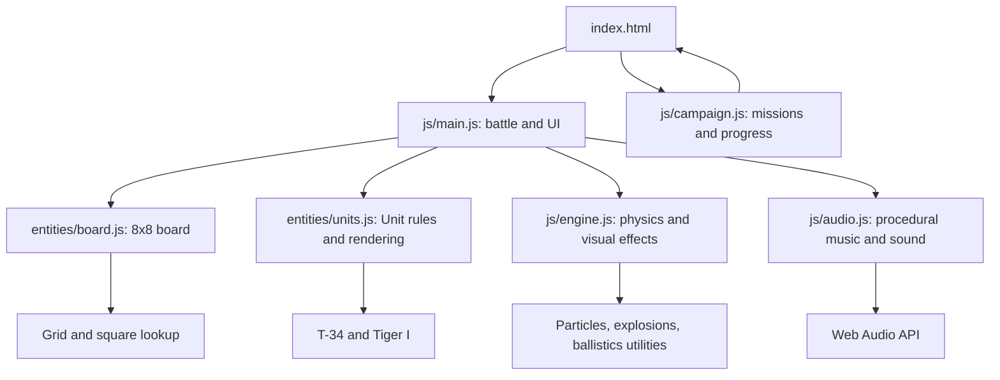
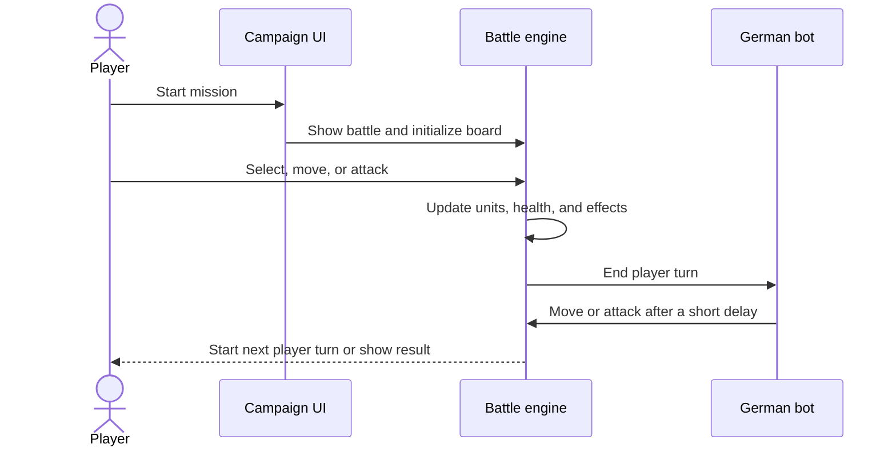

<div align="center">

<svg xmlns="http://www.w3.org/2000/svg" width="100%" viewBox="0 0 1000 300" role="img" aria-labelledby="banner-title banner-desc">
  <title id="banner-title">KURSK 1943 — Turn-based tank battle</title>
  <desc id="banner-desc">An animated neon arcade banner with a battlefield grid and a tank silhouette.</desc>
  <defs>
    <linearGradient id="sky" x1="0" y1="0" x2="1" y2="1">
      <stop offset="0" stop-color="#080914"/><stop offset="1" stop-color="#171a39"/>
    </linearGradient>
    <filter id="cyan-glow" x="-50%" y="-50%" width="200%" height="200%">
      <feGaussianBlur stdDeviation="5" result="blur"/><feMerge><feMergeNode in="blur"/><feMergeNode in="SourceGraphic"/></feMerge>
    </filter>
    <filter id="pink-glow" x="-50%" y="-50%" width="200%" height="200%">
      <feGaussianBlur stdDeviation="4" result="blur"/><feMerge><feMergeNode in="blur"/><feMergeNode in="SourceGraphic"/></feMerge>
    </filter>
    <pattern id="grid" width="40" height="40" patternUnits="userSpaceOnUse">
      <path d="M40 0H0V40" fill="none" stroke="#00e5ff" stroke-opacity=".2" stroke-width="1"/>
    </pattern>
  </defs>
  <rect width="1000" height="300" rx="18" fill="url(#sky)"/>
  <rect width="1000" height="300" rx="18" fill="url(#grid)" opacity=".8">
    <animate attributeName="y" values="0;40" dur="5s" repeatCount="indefinite"/>
  </rect>
  <path d="M0 235H1000" stroke="#ff006e" stroke-opacity=".7" stroke-width="2"/>
  <text x="500" y="124" text-anchor="middle" fill="#00e5ff" font-family="Courier New,monospace" font-size="68" font-weight="900" letter-spacing="9" filter="url(#cyan-glow)">KURSK 1943
    <animate attributeName="opacity" values="1;.82;1" dur="2.4s" repeatCount="indefinite"/>
  </text>
  <text x="500" y="171" text-anchor="middle" fill="#ffd60a" font-family="Courier New,monospace" font-size="17" letter-spacing="4">TURN-BASED TANK BATTLE</text>
  <g transform="translate(455 205)" filter="url(#pink-glow)" fill="none" stroke="#39ff14" stroke-width="4">
    <path d="M-48 18h96l-8 20h-80zM-22 18v-18h40l16 18M0 0v-12h22"/>
    <circle cx="-28" cy="39" r="5" fill="#ffd60a"/><circle cx="28" cy="39" r="5" fill="#ffd60a"/>
    <path d="M25-12h20" stroke="#ff006e" stroke-width="3">
      <animate attributeName="opacity" values="0;0;1;0" keyTimes="0;.72;.76;1" dur="2.2s" repeatCount="indefinite"/>
      <animate attributeName="transform" values="translate(0 0);translate(65 0)" keyTimes="0;.72" dur="2.2s" repeatCount="indefinite"/>
    </path>
  </g>
  <text x="500" y="274" text-anchor="middle" fill="#ff006e" font-family="Courier New,monospace" font-size="11" letter-spacing="3" filter="url(#pink-glow)">COMMAND · MANEUVER · SURVIVE</text>
</svg>

<br/>

[](https://maycolaq.github.io/war/)
[](LICENSE)
[](https://github.com/MaycolAQ/war/releases)
[](https://github.com/MaycolAQ/war)


### A neon-soaked, turn-based tank duel inspired by the Battle of Kursk.

[](https://maycolaq.github.io/war/)

[Project overview](#k<) · [Features](#features) · [Run locally](#run-locally) · [Contributing](#contributing)

</div>

## What is Kursk 1943?

**Kursk 1943** is a lightweight browser game where you command a Soviet T-34 against a German Tiger I on a compact tactical grid. Select a unit, plan a move, and choose when to attack—the opponent is controlled by a simple built-in bot.

It pairs quick, chess-like turns with a retro arcade presentation, procedural sound, and canvas-rendered combat effects. The project is built with static HTML, CSS, and vanilla JavaScript, and runs on GitHub Pages without a build step or JavaScript framework.

> **Historical note:** This is an arcade-style educational game inspired by the 1943 Battle of Kursk, not a historically complete simulation. Unit values and combat rules are simplified for play.

## Play the demo

<div align="center">

[](https://maycolaq.github.io/war/)

</div>

## Contents

- [Why Kursk 1943?](#why-kursk-1943)
- [Features](#features)
- [How to play](#how-to-play)
- [Architecture](#architecture)
- [Technology](#technology)
- [Run locally](#run-locally)
- [Project structure](#project-structure)
- [Contributing](#contributing)
- [License](#license)

## Why Kursk 1943?

The Battle of Kursk, fought in July 1943, was one of the largest armored engagements of the Second World War. This small game borrows its setting and opposing tanks to create an approachable, head-to-head tactical challenge.

1. **Select** your T-34 to reveal available moves and attack targets.
2. **Maneuver** across the 8×8 board; positioning determines which actions are available.
3. **Attack and adapt** as the German bot takes its turn. Destroy the Tiger to win.

## Features

| Feature | What it offers |
| --- | --- |
| ✅ 8×8 tactical board | Alternating high-contrast squares with neon selection and action highlights. |
| ✅ Turn-based player vs. bot | Take your turn, then let the German Tiger respond automatically. |
| ✅ Touch-friendly controls | Select, move, and attack with pointer input on desktop or mobile. |
| ✅ Combat and health | Unit-specific range, movement, attack, damage, and HP bars. |
| ✅ Ballistics utilities | The physics module includes armor-penetration and ricochet calculations; the current grid battle uses its own simplified damage rules. |
| ✅ Procedural audio | Music motifs and battle sound effects are generated in the browser—no MP3 files. |
| ✅ Particles and explosions | Canvas-rendered movement effects, hit flashes, explosions, and victory effects. |
| ✅ Campaign progression | Mission selection and completion progress are stored locally in the browser. |
| ✅ Responsive arcade HUD | Neon frame, pulsing turn badge, and large touch targets; the battle view is designed to fit the viewport. |
| ✅ No JavaScript packages | Plain browser JavaScript; no framework, package manager, or build step required. |
| ✅ Static hosting | The site is served directly from GitHub Pages. |

## How to play

- Select the **T-34** to show legal movement squares and enemies within attack range.
- Tap a highlighted square to move, or a highlighted enemy to attack.
- Use **Pass Turn** if you are done acting; the bot will take its turn.
- Keep an eye on both health bars. Destroy the Tiger I to win.
- Use the music button to toggle the procedural soundtrack. Audio begins after a player interaction, as required by browser autoplay policies.

## Architecture



### Battle flow



## Technology

<div align="center">


[](https://github.com/MaycolAQ/war)

</div>

- **HTML** provides the campaign and battle screens.
- **CSS** handles responsive layout and the arcade visual treatment.
- **Vanilla JavaScript** owns gameplay, campaign progress, and input.
- **Canvas 2D** draws the board, units, and combat effects.
- **Web Audio API** synthesizes music and sound effects in the browser.

## Run locally

The game is a static site. From the repository root, start a local HTTP server:

```bash
python3 -m http.server 8000
```

Then open [http://localhost:8000](http://localhost:8000). You can also use any static file server. No build or dependency installation is needed.

## Project structure

```text
war/
├── index.html
├── README.md
├── css/
│   ├── style.css       # Campaign and shared styles
│   └── arcade.css      # Retro battle presentation
├── entities/
│   ├── board.js        # 8×8 grid and square lookup
│   └── units.js        # Unit behavior and canvas rendering
└── js/
    ├── audio.js        # Procedural music and sound effects
    ├── campaign.js     # Mission selection and local progress
    ├── engine.js       # Ballistics utilities and visual effects
    └── main.js         # Battle rules, bot, input, and rendering
```

## Contributing

Bug reports, gameplay ideas, and focused pull requests are welcome. Before proposing a larger change, open an issue to discuss its scope. Keep changes compatible with static GitHub Pages hosting and avoid adding frameworks or build tooling unless there is a clear need.

## License

This project is distributed under the [MIT License](LICENSE).

---

<div align="center">

**Ready to command?** [Launch Kursk 1943 →](https://maycolaq.github.io/war/)

<sub>Built with HTML, CSS, Canvas, and vanilla JavaScript. No image or video assets required.</sub>

</div>
